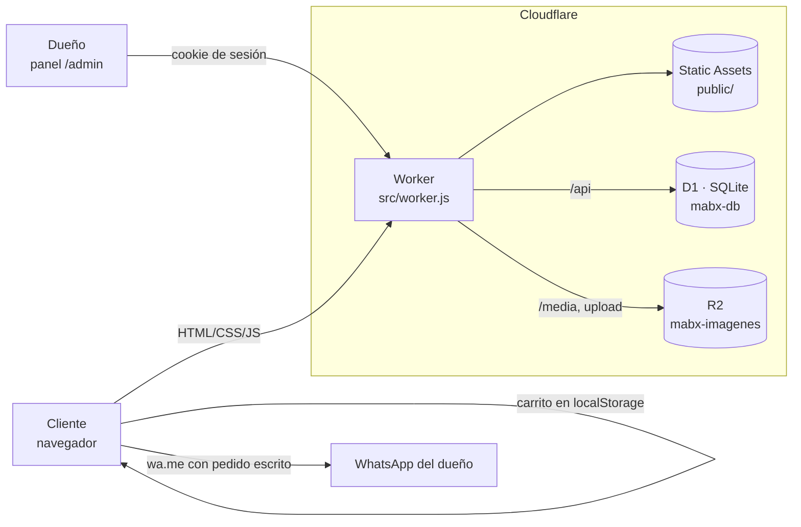
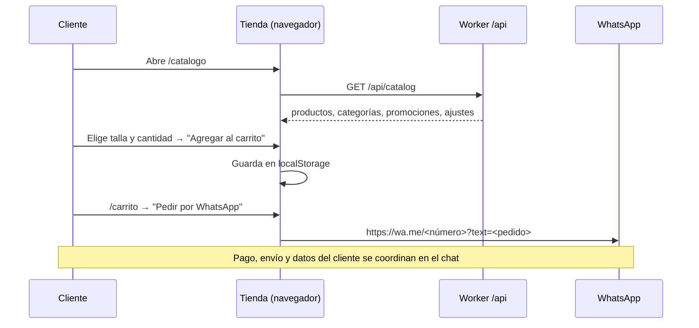
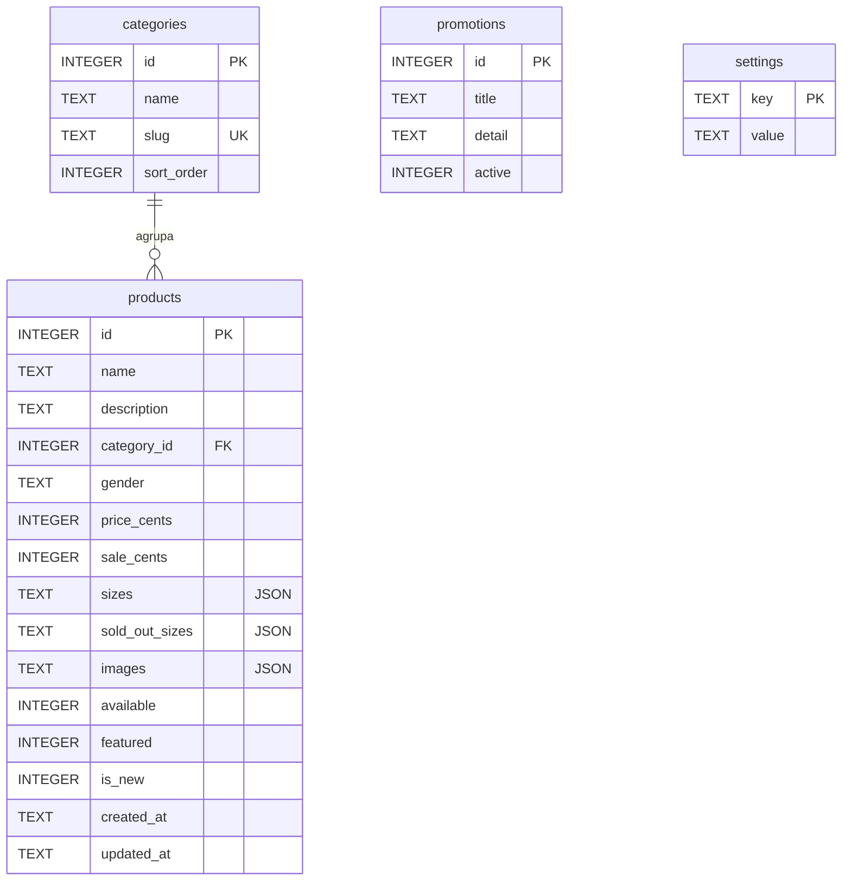

# Mabx · Documentación técnica

> Documento generado a partir del análisis del código del repositorio (rama `main`, noviembre de 2026).
> Todo lo descrito aquí se basa en archivos reales del proyecto. Lo que no se pudo determinar desde el código se marca como **No determinado** o **Pendiente**.

## Tabla de contenidos

1. [Descripción general](#1-descripción-general)
2. [Stack tecnológico](#2-stack-tecnológico)
3. [Arquitectura y estructura del proyecto](#3-arquitectura-y-estructura-del-proyecto)
4. [Funcionalidades](#4-funcionalidades)
5. [Base de datos](#5-base-de-datos)
6. [API / Rutas](#6-api--rutas)
7. [Autenticación y seguridad](#7-autenticación-y-seguridad)
8. [Integraciones externas](#8-integraciones-externas)
9. [Variables de entorno](#9-variables-de-entorno)
10. [Instalación y ejecución](#10-instalación-y-ejecución)
11. [Despliegue e infraestructura](#11-despliegue-e-infraestructura)
12. [Pruebas](#12-pruebas)
13. [Diseño y UX](#13-diseño-y-ux)
14. [Limitaciones, deuda técnica y mejoras sugeridas](#14-limitaciones-deuda-técnica-y-mejoras-sugeridas)

---

## 1. Descripción general

**Mabx** es la tienda en línea de una marca de ropa deportiva ubicada en **Portoviejo, Ecuador**, con envíos a todo el país. Lema: *"Nacidos para superarnos"*.

La web es un **catálogo con carrito y pedidos por WhatsApp**, sin pasarela de pago:

1. El cliente navega el catálogo, filtra y ve el detalle de cada prenda.
2. Agrega prendas (talla + cantidad) a un carrito que se guarda en su navegador.
3. Pulsa **"Pedir por WhatsApp"**: se abre un chat con el número del dueño y un mensaje ya escrito con productos, tallas, cantidades, subtotales y total.
4. El pago, el envío y los datos del cliente (nombre, dirección, ciudad) se coordinan dentro del chat.

| Aspecto | Detalle |
|---|---|
| Problema que resuelve | Vitrina digital siempre actualizada y pedidos ordenados, sin la complejidad (ni las comisiones) de una pasarela de pago |
| Público objetivo | Personas en Ecuador que entrenan (gimnasio, running) o buscan ropa deportiva de uso diario; colecciones de hombre y mujer |
| Cuentas de cliente | No existen: el cliente compra sin registrarse |
| Panel de administración | `/admin`, de uso exclusivo del dueño, para gestionar productos, fotos, tallas agotadas, ofertas, categorías, promociones, recuadros del inicio, WhatsApp y redes sociales |

> **Nota:** el mensaje de WhatsApp que genera la web incluye solo el detalle del pedido (productos, talla, cantidad, precios y total). La web **no recoge** nombre, teléfono, dirección ni ciudad del cliente; esos datos se piden en la conversación.

---

## 2. Stack tecnológico

| Capa | Tecnología | Versión / detalle |
|---|---|---|
| Lenguajes | JavaScript (ES Modules), HTML5, CSS3, SQL (SQLite) | Sin TypeScript ni transpilación |
| Backend | **Cloudflare Workers** (`src/worker.js`) | `compatibility_date: 2026-10-01` |
| Frontend | HTML estático + JavaScript "vanilla" (módulos ES nativos del navegador) | Sin framework (no React/Vue), sin bundler |
| Base de datos | **Cloudflare D1** (SQLite gestionado) | Base `mabx-db`, binding `DB` |
| Almacenamiento de imágenes | **Cloudflare R2** | Bucket `mabx-imagenes`, binding `IMAGES` |
| Archivos estáticos | **Workers Static Assets** | Carpeta `public/`, binding `ASSETS` |
| Estilos | CSS propio con variables (custom properties) | `styles.css` (tienda, ~760 líneas) y `admin.css` (panel, ~210 líneas). Sin Tailwind ni preprocesador |
| Tipografías | Google Fonts | *Saira Condensed* (700, 800) para títulos, *Inter* (400–700) para texto |
| Animaciones | `motion.js` propio (IntersectionObserver + MutationObserver) y Web Animations API | Respeta `prefers-reduced-motion` |
| Herramienta de desarrollo y despliegue | **Wrangler** (CLI de Cloudflare) | `^4.158.0` (instalada: 4.158.0), única dependencia (`devDependencies`) |
| Gestor de paquetes | npm | `package-lock.json` presente |
| Entorno de ejecución local | Node.js | 20 o superior (según el README) |

No hay dependencias de producción: el navegador carga el JS directamente desde `public/assets/js/`.

---

## 3. Arquitectura y estructura del proyecto

### 3.1 Árbol de carpetas

```text
Mabx/
├── src/
│   └── worker.js            # Backend completo: API REST, login del dueño y servidor de fotos (/media)
├── public/                  # Todo lo que se sirve como archivo estático
│   ├── index.html           # Inicio (hero, destacados, colecciones, historia, pasos, promociones)
│   ├── catalogo.html        # Catálogo con filtros y orden   → /catalogo
│   ├── producto.html        # Ficha de producto              → /producto?id=N
│   ├── carrito.html         # Carrito + "Pedir por WhatsApp" → /carrito
│   ├── favicon.svg
│   ├── admin/               # Panel del dueño (no indexado: meta robots noindex)
│   │   ├── index.html       # Login                          → /admin
│   │   ├── productos.html   # Listado, búsqueda, acciones rápidas, "Optimizar fotos"
│   │   ├── editar.html      # Crear / editar producto        → /admin/editar[?id=N]
│   │   └── config.html      # WhatsApp, redes, envíos, recuadros del inicio, categorías, promociones
│   ├── assets/
│   │   ├── css/
│   │   │   ├── styles.css   # Estilos de la tienda (tokens de color, layout, responsive)
│   │   │   └── admin.css    # Estilos del panel
│   │   └── js/
│   │       ├── common.js    # Utilidades públicas: catálogo, carrito (localStorage), tarjetas, header/footer, WhatsApp
│   │       ├── admin.js     # Utilidades del panel: cliente API, sesión, barra lateral, conversión de fotos a WEBP
│   │       └── motion.js    # Animaciones de aparición al hacer scroll
│   └── img/                 # Banners y fotos de ejemplo en WEBP (varias resoluciones)
│       └── demo/            # Fotos de los productos de ejemplo
├── migrations/              # Migraciones SQL de D1 (se aplican en orden)
│   ├── 0001_inicial.sql         # Tablas
│   ├── 0002_datos_ejemplo.sql   # Categorías, productos, promoción y ajustes de ejemplo
│   ├── 0003_fotos_dama.sql      # Nuevas fotos de camisetas de mujer
│   ├── 0004_fotos_webp.sql      # Rutas de fotos de ejemplo .png → .webp
│   └── 0005_tallas_agotadas.sql # Columna sold_out_sizes
├── wrangler.jsonc           # Configuración de Cloudflare (Worker, assets, D1, R2, variables)
├── package.json             # Scripts npm y dependencia de wrangler
├── .dev.vars.example        # Plantilla de secretos para desarrollo local
├── README.md                # Guía de uso y publicación (orientada al dueño)
├── skills.zip               # Material de referencia (no forma parte de la web)
└── .idea/, .Rhistory        # Archivos del editor (no forman parte de la web)
```

### 3.2 Cómo se organiza el código

- **Un solo Worker** atiende todas las peticiones:
  - `/api/*` → API JSON (pública o de administración).
  - `/media/*` → fotos subidas por el dueño, leídas desde R2.
  - Cualquier otra ruta → archivo estático de `public/` (Workers Static Assets resuelve `/catalogo` → `catalogo.html`).
- **Frontend sin build**: cada página HTML trae su lógica en un `<script type="module">` que importa `common.js` (tienda) o `admin.js` (panel).
- **Una sola llamada de datos por página**: la tienda pide `GET /api/catalog` una vez (productos, categorías, promociones activas y ajustes públicos) y filtra, ordena y pinta todo en el navegador.
- **Carrito en el cliente**: se guarda en `localStorage` (clave `mabx_cart_v1`) como `[{ id, size, qty }]`. Los precios se recalculan siempre con el catálogo vigente.

### 3.3 Diagrama de arquitectura



### 3.4 Flujo de compra



---

## 4. Funcionalidades

Leyenda: ✅ Completa · 🟡 Parcial · ⏳ Pendiente / no implementada

### 4.1 Tienda pública

| Módulo | Estado | Detalle |
|---|---|---|
| Inicio | ✅ | Hero con banner responsive, barra de beneficios, **Destacados** (productos `featured`, completa hasta 4 con otros disponibles), recuadros de colección Mujer/Hombre (foto y título editables desde el panel), sección de marca, "Pide en 3 pasos" y bloque de promociones activas |
| Catálogo | ✅ | Cuadrícula de productos; los agotados se muestran al final |
| Filtros | ✅ | Solo ofertas, solo disponibles, categoría, género (unisex aparece en ambos), talla (ignora tallas agotadas), precio máximo (rango). Píldoras de filtros activos, contador y "Limpiar todo". Accesos rápidos: Todo / Mujer / Hombre / Ofertas |
| Filtros por URL | ✅ | `?ofertas=1`, `?cat=<slug>`, `?genero=hombre\|mujer` |
| Ordenamiento | ✅ | Más recientes, precio ascendente/descendente, mayor descuento |
| Búsqueda por texto | ⏳ | No existe buscador en la tienda (solo en el panel) |
| Detalle de producto | ✅ | Galería con miniaturas, zoom con el cursor (solo escritorio), precio con ahorro, etiquetas (Agotado / -X% / Nuevo), selector de talla (tallas agotadas deshabilitadas), cantidad (1–99), info de envío, productos relacionados (prioriza misma categoría) |
| Carrito | ✅ | Agrupa por producto + talla, cambiar cantidad, quitar (con animación), subtotal, descuentos, total estimado, envío "A coordinar", vista previa del mensaje, barra fija en celular. Elimina productos borrados del catálogo y excluye del pedido prendas o tallas agotadas |
| Checkout | 🟡 | Sustituido por el pedido por WhatsApp; no hay formulario de datos del cliente |
| Pagos en línea | ⏳ | No implementado por diseño: el pago se coordina por WhatsApp |
| Pedido por WhatsApp | ✅ | Mensaje configurable con plantilla `{productos}` y `{total}` |
| Registro / login de clientes | ⏳ | No existe (decisión del negocio: "sin cuentas") |
| Perfil de usuario | ⏳ | No existe |
| Historial de pedidos | ⏳ | Los pedidos no se guardan en la base de datos |
| Envíos / cálculo de costo | 🟡 | Solo texto informativo editable (`shipping_info`); costo y tiempo se coordinan por WhatsApp |
| Cupones | ⏳ | No implementado |
| Reseñas | ⏳ | No implementado |
| Contacto y redes | ✅ | Pie de página con botón de WhatsApp y enlaces a Instagram/TikTok/Facebook si están configurados |

### 4.2 Panel de administración (`/admin`)

| Módulo | Estado | Detalle |
|---|---|---|
| Login | ✅ | Correo + contraseña, "recordarme" (7 días; si no, 12 h), mostrar/ocultar contraseña |
| Listado de productos | ✅ | Miniatura, tallas y tallas agotadas, categoría, precio, estado; contadores de activos, en oferta y agotados; búsqueda por nombre |
| Acciones rápidas | ✅ | Destacar / quitar de destacados, marcar disponible/agotado, eliminar (con confirmación) |
| Crear / editar producto | ✅ | Nombre, descripción, categoría, género, precio, precio de oferta, tallas (predefinidas XS–XXL + personalizadas), tallas agotadas, disponible, destacado, nuevo. Vista previa en vivo de la tarjeta y aviso de cambios sin guardar |
| Fotos de producto | ✅ | Hasta 10 por producto, arrastrar y soltar, subida en paralelo, cambiar portada, quitar. Conversión a WEBP en el navegador (máx. 1600 px, calidad 0,82) antes de subir |
| Optimizar fotos antiguas | ✅ | Botón que convierte a WEBP las fotos subidas antes de la conversión automática |
| Inventario | 🟡 | Solo estados: disponible/agotado por producto y por talla. No hay cantidades en stock |
| Categorías | ✅ | Crear, renombrar, eliminar (los productos quedan "Sin categoría"), contador de productos |
| Promociones | ✅ | Crear, activar/pausar, eliminar. Son avisos de texto; **no** aplican descuentos automáticos (el descuento real es el precio de oferta de cada producto) |
| Configuración | ✅ | Número de WhatsApp (con botón de prueba), mensaje base, redes sociales, texto de envíos |
| Recuadros del inicio | ✅ | Foto y título de los recuadros Mujer/Hombre, con opción de volver a la foto original |
| Gestión de pedidos | ⏳ | No existe: los pedidos viven en WhatsApp |
| Varios administradores / roles | ⏳ | Un único usuario administrador |

---

## 5. Base de datos

Motor: **Cloudflare D1 (SQLite)**. Esquema definido por las migraciones de `migrations/`.

### 5.1 Tablas

#### `products`

| Campo | Tipo | Descripción |
|---|---|---|
| `id` | INTEGER PK autoincremental | Identificador |
| `name` | TEXT, obligatorio | Nombre (máx. 120 caracteres, validado en la API) |
| `description` | TEXT | Descripción (máx. 2000) |
| `category_id` | INTEGER → `categories.id` | `ON DELETE SET NULL`; con índice `idx_products_category` |
| `gender` | TEXT | `hombre` · `mujer` · `unisex` |
| `price_cents` | INTEGER, obligatorio | Precio normal en centavos (2190 = $21.90) |
| `sale_cents` | INTEGER, nulo | Precio de oferta en centavos; `NULL` = sin oferta |
| `sizes` | TEXT (JSON) | Ej. `["S","M","L"]` (máx. 20) |
| `sold_out_sizes` | TEXT (JSON) | Subconjunto de `sizes` agotado (migración 0005) |
| `images` | TEXT (JSON) | Rutas `/media/...` o `/img/...` (máx. 10); la primera es la portada |
| `available` | INTEGER 0/1 | 1 disponible, 0 agotado |
| `featured` | INTEGER 0/1 | Aparece en "Destacados" |
| `is_new` | INTEGER 0/1 | Etiqueta "Nuevo" |
| `created_at`, `updated_at` | TEXT | Fecha y hora (`datetime('now')`) |

#### `categories`

| Campo | Tipo | Descripción |
|---|---|---|
| `id` | INTEGER PK | Identificador |
| `name` | TEXT | Nombre visible (máx. 60) |
| `slug` | TEXT UNIQUE | Generado del nombre; se usa en `?cat=` |
| `sort_order` | INTEGER | Orden de aparición |

#### `promotions`

| Campo | Tipo | Descripción |
|---|---|---|
| `id` | INTEGER PK | Identificador |
| `title` | TEXT | Ej. "-20% Camisetas Mujer" (máx. 80) |
| `detail` | TEXT | Ej. "Vence 30 nov" (máx. 120) |
| `active` | INTEGER 0/1 | Solo las activas se muestran en la tienda |

#### `settings` (clave–valor)

| Clave | Uso |
|---|---|
| `whatsapp_number` | Número del dueño con código de país, solo dígitos (mín. 8) |
| `whatsapp_message` | Plantilla del mensaje del pedido (`{productos}`, `{total}`) |
| `instagram`, `tiktok`, `facebook` | Enlaces a redes sociales |
| `shipping_info` | Texto de envíos que ve el cliente |
| `tile_mujer_image`, `tile_mujer_title`, `tile_hombre_image`, `tile_hombre_title` | Recuadros de colección del inicio |

### 5.2 Diagrama ER



`promotions` y `settings` no tienen relaciones con otras tablas. Las fotos no se guardan en la base: viven en R2 y la base guarda su ruta.

### 5.3 Datos de ejemplo

La migración `0002` crea 4 categorías (Camisetas, Shorts, Tops, Accesorios), 4 camisetas de ejemplo, una promoción y los ajustes iniciales. El número de WhatsApp de ejemplo es ficticio y debe cambiarse desde el panel.

---

## 6. API / Rutas

### 6.1 Páginas (archivos estáticos)

| Ruta | Archivo | Acceso |
|---|---|---|
| `/` | `public/index.html` | Público |
| `/catalogo` (`?ofertas=1`, `?cat=`, `?genero=`) | `public/catalogo.html` | Público |
| `/producto?id=N` | `public/producto.html` | Público |
| `/carrito` | `public/carrito.html` | Público (noindex) |
| `/admin` | `public/admin/index.html` | Login |
| `/admin/productos` | `public/admin/productos.html` | Requiere sesión (comprobación en el navegador; los datos los protege la API) |
| `/admin/editar[?id=N]` | `public/admin/editar.html` | Requiere sesión |
| `/admin/config` | `public/admin/config.html` | Requiere sesión |

### 6.2 API JSON (`src/worker.js`)

| Método | Ruta | Descripción | Autenticación |
|---|---|---|---|
| GET | `/api/catalog` | Productos (con stock calculado), categorías, promociones activas y ajustes públicos | No |
| POST | `/api/login` | Inicia sesión. Cuerpo: `{ email, password, remember }`. Devuelve cookie `mabx_session` | No |
| POST | `/api/logout` | Borra la cookie de sesión | No |
| GET | `/api/me` | `{ admin: true\|false }` | No |
| GET | `/api/admin/catalog` | Igual que el catálogo, pero con todas las promociones, todos los ajustes y productos sin modificar | Sí |
| POST | `/api/admin/products` | Crea producto | Sí |
| PUT | `/api/admin/products/:id` | Reemplaza producto; borra de R2 las fotos quitadas | Sí |
| PATCH | `/api/admin/products/:id` | Cambio rápido de `available`, `featured` o `is_new` | Sí |
| DELETE | `/api/admin/products/:id` | Elimina producto y sus fotos en R2 | Sí |
| POST | `/api/admin/categories` | Crea categoría | Sí |
| PUT | `/api/admin/categories/:id` | Renombra categoría | Sí |
| DELETE | `/api/admin/categories/:id` | Elimina categoría (productos → sin categoría) | Sí |
| POST | `/api/admin/promotions` | Crea promoción | Sí |
| PUT | `/api/admin/promotions/:id` | Edita / activa / pausa promoción | Sí |
| DELETE | `/api/admin/promotions/:id` | Elimina promoción | Sí |
| PUT | `/api/admin/settings` | Guarda ajustes (solo claves permitidas); borra de R2 fotos de recuadros reemplazadas si ya no se usan | Sí |
| POST | `/api/admin/upload` | Sube una imagen (`multipart/form-data`, campo `file`, máx. 5 MB, JPG/PNG/WEBP/AVIF). Devuelve `{ url: "/media/productos/..." }` | Sí |
| GET | `/media/<clave>` | Sirve una foto desde R2 con caché de 1 año (`immutable`) | No |

**Errores:** todas las respuestas de error son JSON `{ "error": "mensaje" }` con códigos 400, 401, 403, 404, 409 o 500. Las respuestas de la API llevan `cache-control: no-store`.

**Ejemplo de producto devuelto:**

```json
{
  "id": 3,
  "name": "Camiseta Hombre · Negra",
  "description": "…",
  "category_id": 1,
  "gender": "hombre",
  "price": 25.9,
  "sale_price": 21.9,
  "sizes": ["XS", "S", "M", "L", "XL"],
  "sold_out_sizes": [],
  "images": ["/img/demo/hombre-negra.webp"],
  "available": true,
  "featured": true,
  "is_new": false,
  "created_at": "2026-11-09 12:00:00"
}
```

---

## 7. Autenticación y seguridad

### 7.1 Sesión del administrador

- **Un único administrador.** El correo se define en la variable `ADMIN_EMAIL` (`wrangler.jsonc`) y la contraseña en el secreto `ADMIN_PASSWORD`.
- **Login:** compara correo (sin distinguir mayúsculas) y contraseña con una comparación de tiempo constante (`safeEqual`). Si falla, espera 600 ms antes de responder para frenar intentos repetidos.
- **Token:** cookie `mabx_session` con formato `<expiración>.<firma HMAC-SHA256>` firmada con `SESSION_SECRET` (Web Crypto). No se guarda nada en el servidor (sesión sin estado).
- **Cookie:** `HttpOnly; Secure; SameSite=Strict; Path=/`. Duración: 7 días con "recordarme", 12 horas sin él.
- **Cierre de todas las sesiones:** cambiando `SESSION_SECRET`.
- **Roles:** no existen roles; solo "administrador" o "visitante".

### 7.2 Protecciones implementadas

| Medida | Dónde |
|---|---|
| Rutas `/api/admin/*` exigen cookie válida (401 si no) | `routeApi` |
| Comprobación de origen (`Origin`) en peticiones no-GET del panel (403 si es otro sitio) | `sameOriginOnly` |
| Consultas SQL parametrizadas (`prepare().bind()`); lista blanca de tablas al borrar | Todo el Worker |
| Validación y recorte de longitud de todos los campos; precios a centavos; oferta < precio normal | `saveProduct`, `saveCategory`, `savePromotion`, `saveSettings` |
| Solo se aceptan rutas de imagen `/media/...` o `/img/...` sin `..` | `isImageUrl` |
| Tipo de imagen verificado por los primeros bytes del archivo (no por la extensión), límite de 5 MB | `uploadImage`, `sniffImageType` |
| Protección de rutas en `/media/` frente a `..` | `serveImage` |
| Ajustes privados no se exponen en `/api/catalog` (lista `PUBLIC_SETTINGS`) | `getCatalog` |
| Escapado de HTML de todo el contenido dinámico en el frontend | `esc()` en `common.js` |
| Secretos fuera del repositorio (`.dev.vars` en `.gitignore`; en producción, `wrangler secret`) | Configuración |
| Panel y carrito con `meta robots noindex` | HTML |

### 7.3 Datos personales

La web no almacena datos de clientes: no hay cuentas, el carrito vive en el navegador y los pedidos se envían por WhatsApp. El único dato personal en el sistema es el correo del administrador.

---

## 8. Integraciones externas

| Servicio | Uso | Implementación |
|---|---|---|
| **WhatsApp** (enlaces `wa.me`) | Envío del pedido, contacto general y prueba del número desde el panel | `whatsappUrl()` y `buildOrderMessage()` en `common.js`. No usa la API de WhatsApp Business: es un enlace que abre el chat |
| **Cloudflare D1** | Base de datos | Binding `DB` |
| **Cloudflare R2** | Fotos subidas por el dueño | Binding `IMAGES`, servidas por `/media/` |
| **Cloudflare Workers Observability** | Registros del Worker | `"observability": { "enabled": true }` |
| **Google Fonts** | Tipografías Saira Condensed e Inter | `<link>` en cada página |
| Instagram / TikTok / Facebook | Solo enlaces en el pie de página | Configurables en el panel |
| Pasarela de pago | No hay | — |
| Correo electrónico (envío) | No hay | — |
| Analíticas (Google Analytics, etc.) | No hay | No determinado si se usan las analíticas propias de Cloudflare desde su panel |

---

## 9. Variables de entorno

| Nombre | Tipo | Dónde se define | Descripción |
|---|---|---|---|
| `ADMIN_EMAIL` | Variable pública | `wrangler.jsonc` → `vars` | Correo con el que el dueño entra al panel |
| `ADMIN_PASSWORD` | **Secreto** | Local: `.dev.vars` · Producción: `npx wrangler secret put ADMIN_PASSWORD` | Contraseña del panel |
| `SESSION_SECRET` | **Secreto** | Local: `.dev.vars` · Producción: `npx wrangler secret put SESSION_SECRET` | Clave para firmar las cookies de sesión (cadena aleatoria larga, ≥ 32 caracteres) |

**Bindings de Cloudflare** (configurados en `wrangler.jsonc`, no son variables de texto):

| Binding | Recurso |
|---|---|
| `ASSETS` | Carpeta `public/` |
| `DB` | Base D1 `mabx-db` (requiere `database_id` propio de la cuenta) |
| `IMAGES` | Bucket R2 `mabx-imagenes` |

Plantilla para desarrollo: `.dev.vars.example` (copiar a `.dev.vars`, que está ignorado por git).

---

## 10. Instalación y ejecución

### 10.1 Requisitos previos

- Node.js 20 o superior y npm.
- Cuenta de Cloudflare (solo para publicar; no hace falta para desarrollo local).

### 10.2 Desarrollo local

```bash
npm install
```

```bash
cp .dev.vars.example .dev.vars
```

Edita `.dev.vars` con una contraseña y una clave de sesión propias. Luego crea la base local con datos de ejemplo:

```bash
npm run db:local
```

```bash
npm run dev
```

- Tienda: `http://localhost:8787`
- Panel: `http://localhost:8787/admin` (correo = `ADMIN_EMAIL`, contraseña = `ADMIN_PASSWORD` de `.dev.vars`)

Wrangler simula D1 y R2 localmente en la carpeta `.wrangler/` (ignorada por git).

### 10.3 Scripts disponibles

| Script | Comando | Uso |
|---|---|---|
| `npm run dev` | `wrangler dev` | Servidor local |
| `npm run db:local` | `wrangler d1 migrations apply mabx-db --local` | Aplica migraciones a la base local |
| `npm run db:remote` | `wrangler d1 migrations apply mabx-db --remote` | Aplica migraciones a la base de producción |
| `npm run deploy` | `wrangler deploy` | Publica el Worker y los archivos estáticos |

### 10.4 Build

No hay paso de build: los archivos de `public/` se publican tal cual.

### 10.5 Publicar desde cero

```bash
npx wrangler login
```

```bash
npx wrangler d1 create mabx-db
```

Copia el `database_id` que devuelve en `wrangler.jsonc`, luego:

```bash
npm run db:remote
```

```bash
npx wrangler r2 bucket create mabx-imagenes
```

```bash
npx wrangler secret put ADMIN_PASSWORD
```

```bash
npx wrangler secret put SESSION_SECRET
```

```bash
npm run deploy
```

Después, en `/admin` → **Configuración**, coloca el número real de WhatsApp (formato `593…` sin el 0 inicial).

### 10.6 Operación de la base de datos

Consultar productos en producción:

```bash
npx wrangler d1 execute mabx-db --remote --command "SELECT id, name, price_cents, available FROM products"
```

Copia de seguridad:

```bash
npx wrangler d1 export mabx-db --remote --output respaldo.sql
```

Para cambios de esquema, crea una nueva migración numerada en `migrations/` y aplícala con `npm run db:local` / `npm run db:remote`.

---

## 11. Despliegue e infraestructura

| Elemento | Estado |
|---|---|
| Hosting | **Cloudflare Workers** (Worker `mabx`) con Static Assets, D1 y R2. Plan gratuito suficiente según el README |
| Base de datos remota | Configurada: `wrangler.jsonc` contiene un `database_id` real y el historial de git incluye "Corrección de base de datos remota" |
| URL pública | No determinado (por defecto, `https://mabx.<subdominio>.workers.dev`) |
| Dominio propio | No determinado / Pendiente. El README describe cómo añadirlo (Workers & Pages → Domains & Routes) |
| CI/CD | No existe: no hay `.github/workflows` ni otra configuración. El despliegue es manual con `npm run deploy` |
| Repositorio | GitHub (remoto `origin`) |
| Respaldos | Manuales con `wrangler d1 export`; D1 Time Travel automático (según el README) |
| Monitoreo | Workers Observability activado (logs en el panel de Cloudflare) |

---

## 12. Pruebas

**No existen pruebas automatizadas**: no hay archivos de test, framework de pruebas (Vitest, Jest, Playwright…) ni script `test` en `package.json`.

La verificación actual es manual con `npm run dev`. Ver la sección 14 para una propuesta.

---

## 13. Diseño y UX

### 13.1 Identidad visual

- Tema oscuro (`--bg: #0A0A0A`) con acento verde lima (`--ac: #C6F500`) y verde WhatsApp para los botones de pedido.
- Emblema de brújula (SVG generado en `common.js`) usado en logo, hero, estados vacíos y animaciones.
- Títulos en *Saira Condensed*; texto en *Inter*. Tokens de diseño en variables CSS (`:root` de `styles.css`).

### 13.2 Páginas principales

| Vista | Elementos clave |
|---|---|
| Inicio | Hero a pantalla completa, beneficios, destacados, colecciones, historia de marca, 3 pasos, promociones |
| Catálogo | Cabecera con accesos rápidos, panel de filtros (plegable en celular), barra de resultados con orden |
| Producto | Migas de pan, galería con zoom, selector de talla/cantidad, relacionados |
| Carrito | Indicador de pasos, lista de prendas, resumen, vista previa tipo burbuja de WhatsApp, barra fija en celular |
| Panel | Barra lateral (en celular pasa a barra inferior), tablas adaptadas a celular, formularios con vista previa |

### 13.3 Responsive y rendimiento

- Breakpoints principales: 860 px (celular), 1100 px (tablet) y ajustes por altura de pantalla.
- Imágenes WEBP con `srcset`/`sizes`; el banner del hero se precarga con `fetchpriority="high"` y en celular nunca descarga la versión de 3344 px.
- Imágenes de tarjetas con `loading="lazy"`; esqueletos de carga mientras llega el catálogo.
- Fotos subidas comprimidas en el navegador antes de enviarse; `/media/` con caché de un año.

### 13.4 Accesibilidad

- Enlace "Saltar al contenido", `aria-current` en la navegación, `aria-expanded` en el menú móvil, cierre con Escape.
- `aria-pressed` en chips de talla y filtros, `aria-live` en contadores y avisos (toasts), etiquetas `aria-label` descriptivas en botones de icono.
- `fieldset`/`legend` en filtros; etiquetas asociadas a todos los campos del panel.
- Contraste revisado (comentario de contraste AA en `--dim`).
- `prefers-reduced-motion` desactiva animaciones; `motion.js` tiene un mecanismo de seguridad que muestra todo si falla.
- Mensaje `<noscript>`: sin JavaScript no se ven los productos.

### 13.5 SEO

| Elemento | Estado |
|---|---|
| `lang="es"`, `<title>` y `meta description` por página | ✅ |
| Open Graph (título, descripción, imagen) | 🟡 Solo en el inicio |
| Título y descripción dinámicos en la ficha de producto | 🟡 Se cambian por JavaScript (los buscadores pueden no verlos) |
| `noindex` en carrito y panel | ✅ |
| `robots.txt` y `sitemap.xml` | ⏳ No existen |
| Datos estructurados (schema.org `Product`) | ⏳ No existen |
| Contenido renderizado en el servidor | ⏳ Los productos se pintan en el navegador |

---

## 14. Limitaciones, deuda técnica y mejoras sugeridas

### 14.1 Limitaciones funcionales

1. **El pedido no incluye datos del cliente** (nombre, ciudad, dirección, teléfono). Se piden manualmente en el chat.
2. **Los pedidos no quedan registrados** en el sistema: no hay historial, estadísticas ni seguimiento.
3. **Inventario sin cantidades**: solo disponible/agotado por producto y por talla; no se descuenta stock al vender.
4. **Promociones solo informativas**: el título "-20%" no aplica descuento; hay que poner el precio de oferta en cada producto.
5. **Sin búsqueda por texto** en la tienda.
6. **Sin variantes de color**: cada color es un producto distinto.
7. **Un único administrador**, sin recuperación de contraseña desde la web.

### 14.2 Deuda técnica

| Problema | Impacto | Sugerencia |
|---|---|---|
| Sin pruebas automatizadas | Riesgo de regresiones al cambiar el Worker | Añadir Vitest con `@cloudflare/vitest-pool-workers` para la API y Playwright para el flujo de compra |
| Sin CI/CD | Despliegues manuales | GitHub Actions: pruebas + `wrangler deploy` al hacer merge en `main` |
| SEO dependiente de JavaScript | Productos poco visibles en buscadores | Generar en el Worker el HTML (o al menos `<title>`, `meta` y Open Graph) de `/producto`; añadir `sitemap.xml` dinámico y `robots.txt` |
| Sin encabezados de seguridad (CSP, `X-Frame-Options`, `Referrer-Policy`) | Defensa en profundidad limitada | Añadirlos en el Worker o con `_headers` |
| Login sin límite real de intentos (solo retardo de 600 ms) | Fuerza bruta posible en teoría | Rate limiting de Cloudflare o Turnstile en el login |
| Sesión sin revocación individual (logout solo borra la cookie del navegador) | Un token robado vale hasta su expiración | Aceptable para un solo usuario; se puede rotar `SESSION_SECRET` |
| Enlaces de redes sociales no validados en el servidor | Un enlace mal formado se publicaría tal cual | Validar que empiecen por `https://` en `saveSettings` |
| `sort_order` de categorías no editable desde el panel | Orden fijo por creación | Añadir reordenamiento |
| `getCatalog` devuelve todo el catálogo en cada carga | Correcto para un catálogo pequeño; crecerá con cientos de productos | Paginación o caché (Cache API) si el catálogo crece |
| Archivos ajenos a la web en el repositorio (`.idea/`, `.Rhistory`, `skills.zip`) | Ruido en el repositorio | Quitarlos de git y añadirlos a `.gitignore` |
| `wrangler.jsonc` contiene el correo del administrador y el `database_id` | Datos de la cuenta visibles si el repositorio es público | Mover `ADMIN_EMAIL` a secreto si se quiere ocultar |
| README indica `admin@mabx.com` como correo local, pero se usa `ADMIN_EMAIL` de `wrangler.jsonc` | Confusión al probar en local | Actualizar el README |

### 14.3 Próximos pasos recomendados

1. **Formulario de datos de envío en el carrito** (nombre, ciudad/provincia, dirección, teléfono) incluido en el mensaje de WhatsApp.
2. **Registro de pedidos** en una tabla `orders` al pulsar "Pedir por WhatsApp", con estados (pendiente, pagado, enviado) en el panel.
3. **Stock por talla** con cantidades.
4. **SEO**: renderizado en servidor de la ficha de producto, sitemap, datos estructurados y Open Graph por producto.
5. **Pruebas y CI** (ver tabla anterior).
6. **Buscador** en el catálogo y **variantes de color**.
7. **Tabla de costos de envío por provincia** o tarifa fija configurable.
8. **Analíticas** respetuosas de la privacidad (por ejemplo, Cloudflare Web Analytics) para medir visitas y clics en "Pedir por WhatsApp".
